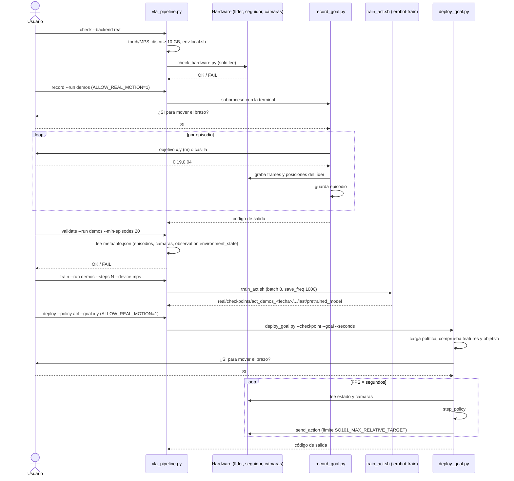
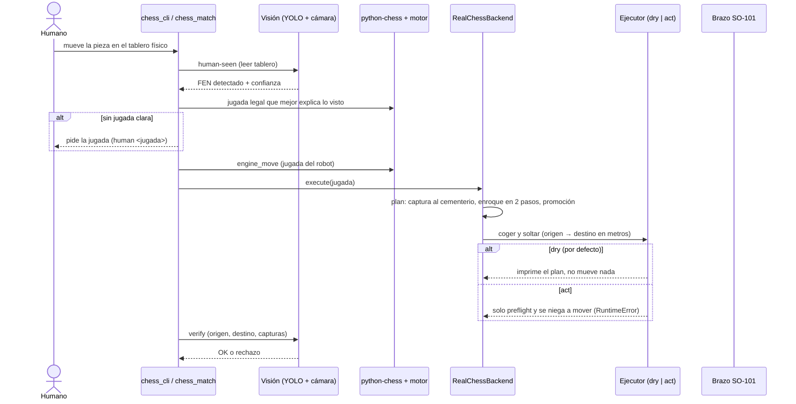

# Contexto de la sesión: estado del proyecto y pipelines

Documento para comparar con el contexto que tiene Claude Code (AGENTS.md, memoria, skills).
Todo lo marcado como **verificado** se comprobó leyendo ficheros o procesos. Lo marcado como **código** se dedujo leyendo el código, no ejecutándolo.

## 1. Qué fuentes de contexto existen

| Fuente | Ruta | Qué aporta |
|---|---|---|
| Instrucciones del proyecto | `AGENTS.md` | Reglas: MPS, Python `.venv312`, unidades en grados, seguridad del brazo, git, modo hackathon |
| Checklist del evento | `CHECKLIST.md` | Orden paso a paso del hackathon (secciones 0–9) |
| Contexto del host | `CONTEXTO_HOST.md` | Estado del dataset limpio, entrenamiento de prueba y pendientes |
| Guía general | `GUIA_SO101.md` | Anterior al pipeline ACT (usa `record.sh`, `rollout.sh`, SmolVLA) |
| Pipeline | `pipeline/VALIDACION_HOST.md`, `pipeline/vla_pipeline.py` | Orquestador por etapas |
| Skills | `.claude/skills/` (17) | Flujos: ajedrez real, calibración, hardware, MPS, grabación maestra, etc. |
| Memoria | `~/.claude/projects/-Users-david-Desktop-lerobot-nvidia/memory/` | 2 entradas (ver §6) |
| **No existe** | `CLAUDE.md` en la raíz | Las instrucciones del proyecto viven en `AGENTS.md` |

Diferencia clave para la comparación: `AGENTS.md` es la fuente de reglas del repo. La memoria guarda hechos de conversaciones previas. Si Claude Code tiene otra copia de las reglas, conviene comprobar que coincide con `AGENTS.md`.

## 2. Reglas de seguridad y operación (de AGENTS.md)

- Dispositivo: `mps` por defecto. `cpu` solo si MPS no está disponible. `cuda` solo con GPU NVIDIA confirmada y pedida explícitamente.
- MLX no está integrado: no proponerlo sin plan de portado.
- Python: `./.venv312/bin/python` (3.12, LeRobot 0.7.0). Visor MuJoCo en macOS: `./.venv312/bin/mjpython`.
- Unidades: brazo real y checkpoint en **grados**; pinza 0..100.
- Movimiento real: sin `ALLOW_REAL_MOTION=1` y sin **SI** explícito del usuario en el chat. Primera prueba con `SO101_MAX_RELATIVE_TARGET=2` y 15–20 s.
- Entrenamientos de más de 2.000 pasos: avisar del tiempo (~0,9 s/paso a 240x320, batch 8, mps) y pedir confirmación.
- Git: sin commit ni push sin pedido explícito. No borrar `real/datasets/` ni `pipeline/runs/`.
- Cambios de luz: no durante una grabación.

## 3. Pipeline ACT: `pipeline/vla_pipeline.py` (código)

Etapas: `check` → `record` → `validate` → `train` → `deploy` (+ `status`).

Valores por defecto relevantes (código):
- `train`: `--steps` 5000, `--device` mps. Sin confirmación.
- `deploy`: `--policy` **smolvla** por defecto, `--seconds` **60** por defecto, `--goal` obligatorio para ACT.
- `deploy_goal.py`: `SO101_MAX_RELATIVE_TARGET` por defecto **5** si no está en el entorno; `--device` por defecto `SO101_VLA_DEVICE` o mps.
- `record`: en real exige `ALLOW_REAL_MOTION=1` y además `record_goal.py` pide SI una vez antes de grabar.

## 4. Turno de ajedrez con el brazo real (código)

Ejecutor: `CHESS_REAL_EXECUTOR`, por defecto `dry`. Backend: `CHESS_BACKEND=real`.

Hechos del ajedrez (de la skill `so101-ajedrez-real`):
- Ejecutor `act` **no mueve**: solo hace preflight. El checkpoint ACT actual no recibe objetivo, así que no puede jugar una jugada concreta.
- Geometría real: `hub/chess_board_real.json` (calibración por contacto, pendiente en CHECKLIST §5.0). Sin ese fichero el ejecutor real se niega.
- Orientación: etiquetas estándar del sistema; las impresas del tablero están espejadas.
- Visión medida: recall 0,94 y precisión 0,98 por pieza en 17 fotos de validación.

## 5. Estado verificado (solo lectura, sin ejecutar pipelines)

- **Verificado:** `pipeline/runs/` vacío. Ninguna etapa registrada en `state.json`.
- **Verificado:** `real/datasets/test1` existe (20 nov). No existe `real/checkpoints/`: no hay entrenamiento ACT lanzado con el pipeline aquí.
- **Verificado:** `checkpoints/act_tray_test200/model.safetensors` pesa 134 bytes: puntero de Git LFS, no pesos. Hace falta `git lfs pull`. El checkpoint usable según la skill es `modeloACT/checkpoints/last/pretrained_model`.
- **Verificado:** procesos activos: tres `sim/mcp_server.py` y `hub/chess_mcp.py` (desde 14:58). Ni `lerobot`, ni `record`, ni `deploy`, ni `train`.
- **Verificado:** `ALLOW_REAL_MOTION` no está definido en el entorno de la sesión.
- **Verificado:** `SO101_MAX_RELATIVE_TARGET` no aparece en `real/env.sh` ni en `real/env.local.sh`.
- **Pendiente:** CHECKLIST §5.0 (calibración del tablero real), §6 (despliegue con brazo, solo probado en dry-run) y §7 (evaluación).

## 6. Memoria (contenido literal resumido)

**`ajedrez-real-plan.md`** (tipo project, 19 nov)
- El ajedrez existe en simulación (`sim/chess_sim.py`, `sim/chess_cli.py`, `sim/chess_real.py` stub) con skills `so101-ajedrez-mover` y `so101-ajedrez-partida`.
- Para el brazo real: usar `so101-grabacion-maestra` para grabar poses de agarre por tipo de pieza y alturas; las poses reales sustituyen a las estimadas por IK.
- No reescribir skills: cambiar `CHESS_BACKEND`, calibración real en `hub/chess_board.json` e implementar `RealChessBackend`.
- Limitación sim: `forcerange` ±2,94 hace que el brazo se hunda en la fila 1 con el tablero en x=0,20; con x=0,22 el error máximo es 1,3 cm.
- **Posiblemente desactualizada:** ya existen `hub/chess_board_real.json`, `hub/board_touch_calib.py` y `RealChessBackend` en `sim/chess_real.py`.

**`ajedrez-modo-automatico.md`** (tipo feedback, 21 nov)
- El usuario quiere partida real "todo automático" (ACT mueve, YOLO detecta, cámaras ven, Claude orquesta).
- Choca con el SI explícito de AGENTS.md. Diseñar sin SI por jugada, pero sin activar movimiento real sin SI explícito para esa partida. Confirmar si "automático" incluye movimiento real sin SI por jugada. Mantener parada de emergencia.

## 7. Desviaciones respecto a AGENTS.md (código, sin ejecutar)

1. `deploy_goal.py` usa límite de velocidad **5** por defecto; AGENTS exige **2** en la primera prueba. Y no hay ninguna variable definida en los ficheros de entorno.
2. `vla_pipeline.py deploy`: `--seconds` 60 y `--policy` smolvla por defecto. AGENTS fija ACT y 15–20 s en la primera prueba.
3. `vla_pipeline.py train`: 5000 pasos por defecto y sin confirmación por encima de 2.000.

## 8. Qué comparar con Claude Code

Puntos concretos a contrastar:
- ¿Su contexto de reglas coincide con `AGENTS.md` (MPS, grados, SI, `SO101_MAX_RELATIVE_TARGET=2`)?
- ¿Sabe que `pipeline/runs/` está vacío y que el checkpoint de 200 pasos es un puntero LFS?
- ¿Tiene la memoria de ajedrez desactualizada (§6)?
- ¿Cree que el despliegue por defecto usa ACT y 20 s, o smolvla y 60 s (§7.2)?
